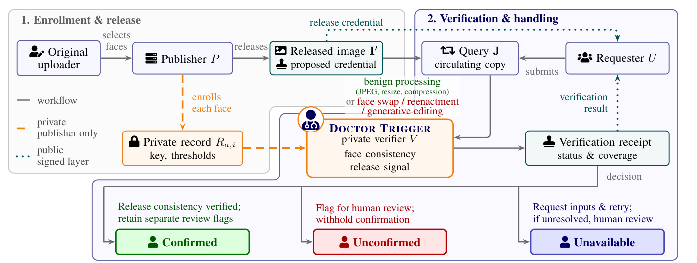
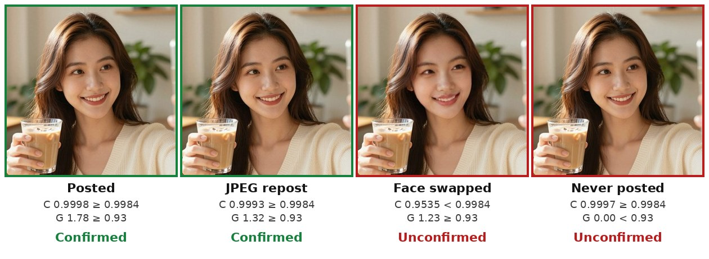

<h1 align="center">Doctor Trigger</h1>

<p align="center"><b>A Framework for Release-Bound Face Verification</b><br>
Check whether a face circulating online is still the version that was released.</p>

<p align="center">
<a href="https://ming053l.github.io/">Chia-Ming Lee</a><sup>1,2</sup>,
Chia-Yu Lin<sup>3</sup>,
Hung-Kai Huang<sup>2</sup>,
Yi-Ting Ku<sup>3</sup>,
Yu-Chen Liang<sup>3</sup>,
<a href="https://cchsu.info/">Chih-Chung Hsu</a><sup>2</sup>
</p>

<p align="center">
<sup>1</sup>University at Albany, SUNY<br>
<sup>2</sup>National Yang Ming Chiao Tung University<br>
<sup>3</sup>National Cheng Kung University
</p>

<p align="center">
<a href="https://ming053l.github.io/Doctor-Trigger/"></a>
<a href="https://ming053l.github.io/Doctor-Trigger/static/pdf/paper.pdf"></a>
<a href="https://ming053l.github.io/Doctor-Trigger/#video"></a>
<a href="LICENSE"></a>
</p>

<p align="center"></p>

## What it does

Posted faces get reposted, compressed, swapped and edited as they spread. Doctor Trigger lets a
publisher check any circulating copy against the specific release it published. Before release, it
adds an invisible keyed signal to the face (51.2 dB PSNR on average) and files a small private
record. Later, a copy is compared with that record: ordinary sharing (JPEG, resizing) passes, a face
swap or generative edit fails, and the never-released original is told apart from the release.

<p align="center"><br>
<sub>Four copies checked against one private record, run with this code (from the project page). All people shown are AI-generated.</sub></p>

## How it works

| Step | What happens | Code |
| --- | --- | --- |
| **1. Enroll** | A per-face secret key shifts the Fourier phase slightly on a mid-frequency ring. The publisher keeps a private record: spectral reference, key and thresholds. | [`workflow/scripts/enroll.py`](workflow/scripts/enroll.py) |
| **2. Verify** | Two checks against the record. *Face consistency* `C`: is this still the enrolled face? *Release signal* `G_s` (key projection): is the keyed signal still there? | [`workflow/record_model/src/trigger_conditioned.py`](workflow/record_model/src/trigger_conditioned.py) |
| **3. Decide** | Thresholds come from benign copies (about 1% benign rejection). An optional learned record model can replace the direct thresholds. | [`workflow/record_model/`](workflow/record_model/) |

| Status | Meaning |
| --- | --- |
| **Confirmed** | Both checks pass: consistent with the enrolled release. |
| **Unconfirmed** | Face consistency or release signal fails (e.g. a swapped face, or an original that was never released). Flagged for human review. |
| **Unavailable** | The record, the face, or a supported channel is missing, so no verdict is given. |

See [`docs/assets/verification.png`](docs/assets/verification.png) for the full verification diagram
and [docs/FAQ.md](docs/FAQ.md) for common questions (is it a watermark? what must stay private?).

## Quick start (no dataset, CPU, a few seconds)

```bash
git clone https://github.com/ming053l/Doctor-Trigger.git && cd Doctor-Trigger
pip install numpy Pillow scikit-image pandas
python examples/quickstart.py
```

```
copy                                              C     G_s  status
posted (released PNG)                        0.9999   1.529  Confirmed
JPEG re-save, q85                            0.9995   1.018  Confirmed
resized 0.75x and back                       0.9998   1.539  Confirmed
unreleased original                          0.9997   0.000  Unconfirmed (release signal missing)
face region replaced                         0.7468   0.716  Unconfirmed (face changed, release signal missing)
center crop 90% (no record of geometry)           -       -  Unavailable
(thresholds)                                 0.9989   0.868
```

The thresholds there come from a toy calibration; see [examples/README.md](examples/README.md).
For the full pipeline (GPU, datasets, SimSwap), see [`workflow/ENVIRONMENT.md`](workflow/ENVIRONMENT.md)
and [`workflow/WORKFLOW.md`](workflow/WORKFLOW.md).

## Data

The paper enrolls 7,366 real faces from FaceForensics++, DFDC and Celeb-DF v2. Request each dataset
from its maintainers ([FF++](https://github.com/ondyari/FaceForensics),
[DFDC](https://ai.meta.com/datasets/dfdc/),
[Celeb-DF](https://github.com/yuezunli/celeb-deepfakeforensics)); nothing is hosted here. Extract
frames to `<frames_root>/<split>/<class>/<video_id>/*.png`, then:

```bash
cd workflow
python scripts/make_source_manifest.py <frames_root> <out>/ffpp_manifest.csv   # once per dataset
export DT_MANIFEST_FFPP=... DT_MANIFEST_DFDC=... DT_MANIFEST_CELEBDF=... DT_SIMSWAP_ROOT=...
./run_workflow.sh --gpu 0      # align faces, enroll, build queries, extract features, train record model
```

Details: [docs/DATA.md](docs/DATA.md).

## Reproducing the paper

Each table and figure is a named entry in [`experiments/registry.yaml`](experiments/registry.yaml),
run against a finished pipeline root:

```bash
cp config.example.yaml config.yaml && python run.py list && python run.py run threshold-transfer
```

[docs/REPRODUCE.md](docs/REPRODUCE.md) maps every paper table and figure to its entry, lists the
external weights each one needs, and explains how peer methods are scored.

## Repository map

```
examples/        dataset-free quick start (two AI-generated sample faces)
workflow/        the pipeline: frames -> aligned faces -> releases + private records -> queries -> features -> record model
  scripts/         one script per stage; enroll.py is the method's release step
  record_model/    verification readings (trigger_conditioned.py) and the optional learned record model
  contracts/       output-file and peer-scoring specifications
  assets/          face-detector weights (SCRFD, YuNet) for alignment
experiments/     the paper's evaluations; registry.yaml maps them to commands
  _snapshot/       trimmed model code they import (image-only detector, benign channels, SimSwap wrapper)
run.py           evaluation entry point: list / show / run / status
dt/              path resolution from config.yaml (copy config.example.yaml)
configs/         record-model training configs used by the evaluations
docs/            DATA, REPRODUCE, FAQ and README figures
```

## Limitations and responsible use

- **Only enrolled faces.** It verifies copies of faces that were enrolled before release, against
  their own records. It is not a general deepfake detector.
- **Known weak spots** (paper Table 4, 200 FF++ releases): face-swap rejection drops to 63% after a
  repost of a repost, 11% under per-image H.264 intra coding, and 6% under a 90% center crop, while
  benign copies still pass. Strong diffusion regeneration and a phase-ring transplant attack also
  weaken it (App. K). Validate on the channels you intend to support.
- **Records are sensitive.** Templates reveal coarse facial structure; keep records, keys and the
  master seed private.
- **Responsible use.** The code is meant for publishers verifying copies of their own releases. Use
  the benchmark datasets under their own terms. All faces in `examples/` and the README figures are
  AI-generated.

## Citation

```bibtex
@misc{lee2026doctortrigger,
  title  = {Doctor Trigger: A Framework for Release-Bound Face Verification},
  author = {Lee, Chia-Ming and Lin, Chia-Yu and Huang, Hung-Kai and Ku, Yi-Ting and Liang, Yu-Chen and Hsu, Chih-Chung},
  year   = {2026},
  note   = {Under review}
}
```

## License

MIT, see [LICENSE](LICENSE). Datasets, peer checkpoints, and engine weights remain under their
original licenses and terms.
