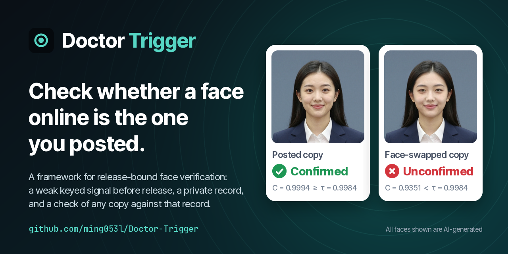

<p align="center"></p>

<p align="center"><b>Doctor Trigger: A Framework for Release-Bound Face Verification</b><br>
<a href="https://ming053l.github.io/">Chia-Ming Lee</a><sup>1,2</sup>,
Chia-Yu Lin<sup>3</sup>, Hung-Kai Huang<sup>2</sup>, Yi-Ting Ku<sup>3</sup>, Yu-Chen Liang<sup>3</sup>,
<a href="https://cchsu.info/">Chih-Chung Hsu</a><sup>2</sup><br>
<sub><sup>1</sup>University at Albany, SUNY &nbsp; <sup>2</sup>National Yang Ming Chiao Tung University &nbsp; <sup>3</sup>National Cheng Kung University</sub></p>

<p align="center">
<a href="https://ming053l.github.io/Doctor-Trigger/"></a>
<a href="https://arxiv.org/abs/2610.16336"></a>
<a href="https://ming053l.github.io/Doctor-Trigger/static/pdf/paper.pdf"></a>
<a href="https://ming053l.github.io/Doctor-Trigger/#video"></a>
<a href="LICENSE"></a>
</p>

<p align="center"><b>Check whether a face online is the one you posted.</b></p>

## What it does

Photos of faces get reposted, compressed, swapped and edited as they spread. Before you post a face, Doctor Trigger adds an invisible keyed signal to it and keeps a small private record. Later, any circulating copy is checked against that record: ordinary sharing (JPEG, resizing) passes, while a face swap, or the original you never posted, does not.

> **Why the name?** *Doctor*: like a doctor who can make a sound call only because your history is on file, the check reads a copy against the record you kept. *Trigger*: the tiny, invisible signal you set in the photo before posting.

<details>
<summary>Four copies of one face, checked with this code</summary>
<p align="center"><br>
<sub>From the project page. All people shown are AI-generated.</sub></p>
</details>

## How it works

| Step | What happens | Paper symbols | Code |
| --- | --- | --- | --- |
| **Enroll** | A per-face secret key becomes a binary ±1 sign pattern on a mid-frequency ring of the face's luminance Fourier phase. The released image carries a weak shift along that pattern (51.2 dB PSNR on average); the publisher keeps the private record. | *s*, *h*<sub>s</sub>, *δ*<sub>s</sub>, *R* | [`enrollment.py`](doctor_trigger/enrollment.py), [`key.py`](doctor_trigger/key.py) |
| **Verify** | A copy is read against the record twice. *Spectral agreement*: is this still the enrolled face? *Key projection*: is the keyed shift still there? | *C* (*C*<sub>B</sub>), *G*<sub>s</sub> | [`readings.py`](doctor_trigger/readings.py) |
| **Decide** | Each reading is compared with a threshold set on benign copies of your releases (about 1% benign rejection). | *τ*<sub>C</sub>, *τ*<sub>G</sub> | [`calibration.py`](doctor_trigger/calibration.py), [`decision.py`](doctor_trigger/decision.py) |

| Status | Meaning |
| --- | --- |
| **Confirmed** | *C* ≥ *τ*<sub>C</sub> and *G*<sub>s</sub> ≥ *τ*<sub>G</sub>: consistent with the posted release. |
| **Unconfirmed** | Either check fails (a swapped face, or an original that was never posted). Flagged for human review. |
| **Unavailable** | The record, the face or a supported channel is missing, so no verdict is given. |

<p align="center"></p>

More: [full verification diagram](docs/assets/verification.png), [FAQ](docs/FAQ.md) (is it a watermark? what must stay private?).

## Quick start

No dataset, no GPU, a few seconds:

```bash
git clone https://github.com/ming053l/Doctor-Trigger.git && cd Doctor-Trigger
pip install -e .                  # Python >= 3.10; numpy, Pillow, scikit-image, ... (CPU only)
python examples/quickstart.py     # enrolls a bundled AI-generated face, checks six copies
```

```
copy                                              C     G_s  status
posted (released PNG)                        0.9999   1.529  Confirmed
JPEG re-save, q85                            0.9995   1.018  Confirmed
resized 0.75x and back                       0.9998   1.539  Confirmed
unreleased original                          0.9997   0.000  Unconfirmed (release signal missing)
face region replaced                         0.7468   0.716  Unconfirmed (face changed, release signal missing)
center crop 90% (no record of geometry)           -       -  Unavailable
(thresholds)                                 0.9989   0.868
```

The thresholds here are a toy calibration; [examples/README.md](examples/README.md) explains each row. The paper's experiments are listed and run from the same command line:

```bash
python -m doctor_trigger list                          # every experiment and the table/figure it feeds
python -m doctor_trigger show threshold-transfer       # its resolved command, cwd and output
python -m doctor_trigger reproduce threshold-transfer  # run it (needs a pipeline root, see below)
```

## Use it on your own photos

```bash
# 1. enroll: writes the image to post (out/face_released.png) and its private record
python -m doctor_trigger enroll face.png --sample-id face --out out/

# 2. verify: prints the readings H_B, C_B and G_s of a circulating copy against the record
python -m doctor_trigger verify copy.png out/face_record_PRIVATE.npz

# 3. calibrate: threshold τ from a column of scores of benign copies of your own releases
python -m doctor_trigger calibrate scores.csv --column C_B --frr 0.01

# 4. verify with the thresholds from step 3: also prints Confirmed, Unconfirmed or Unavailable
python -m doctor_trigger verify copy.png out/face_record_PRIVATE.npz --tau-c TAU_C --tau-g TAU_G
```

Enroll a face-centred crop (the pipeline enrolls aligned face crops). Keep every `*_PRIVATE.npz` private: only the released image is public.

## Repository map

```
doctor_trigger/     the method, plus the command line (python -m doctor_trigger ...)
  spectrum.py         luminance Y, phase φ, normalized radius κ, sub-band B (κ ≤ 0.15)
  key.py              key s, sign pattern h_s (binary ±1), active bins, displacement δ_s
  record.py           private record R (NPZ) and where each enrolled unit's record lives
  enrollment.py       released image I′ and record R for one face, α ladder, fidelity gate
  readings.py         spectral agreement H / C / C_B, key projection G_s, features Φ
  calibration.py      thresholds τ at a target benign false-rejection rate
  decision.py         Confirmed / Unconfirmed / Unavailable
  channels.py         benign delivery channels (JPEG, resizing, one-frame codecs, ...)
  metrics.py          AUC, TPR at a fixed FPR, EER
  record_model.py     optional learned record model f_θ (needs torch)
  config.py           config.yaml paths;  manifests.py: query manifests;  cli.py: commands
examples/           dataset-free quick start (two AI-generated faces)
workflow/           pipeline: frames → faces → releases + records → queries → features → f_θ
experiments/        the paper's evaluations; registry.yaml maps each to its table or figure
configs/            record-model training configs used by the evaluations
tests/              unit and golden-value tests (pip install -e ".[test]" && pytest)
docs/               DATA, REPRODUCE, FAQ and the README figures
run.py              same as python -m doctor_trigger (run = reproduce)
```

## Reproducing the paper

Every table and figure is a named entry in [`experiments/registry.yaml`](experiments/registry.yaml), run with `python -m doctor_trigger reproduce <id>` on a finished pipeline root (`pip install -e ".[experiments]"`, then fill in `config.yaml` from `config.example.yaml`). [docs/REPRODUCE.md](docs/REPRODUCE.md) maps each paper artifact to its entry and lists the external weights it needs.

## Data

The paper enrolls 7,366 real faces from FaceForensics++, DFDC and Celeb-DF v2; nothing is hosted here, so request each dataset from its maintainers. [docs/DATA.md](docs/DATA.md) covers the frame layout and the commands that build the pipeline root.

## Limitations and responsible use

- **Only enrolled faces.** It checks copies of faces enrolled before release, each against its own record. It is not a general deepfake detector.
- **Known weak spots** (paper Table 4, 200 FF++ releases): face-swap rejection drops to 63% after a repost of a repost, 11% under per-image H.264 intra coding and 6% under a 90% center crop, while benign copies still pass. Strong diffusion regeneration and a phase-ring transplant also weaken it (App. K). Validate on the channels you intend to support.
- **Records are sensitive.** A record's template reveals coarse facial structure; keep records, keys and the master seed private.
- **Responsible use.** Meant for publishers checking copies of their own releases. Use the benchmark datasets under their own terms. All faces in `examples/` and in the README figures are AI-generated.

## Roadmap

Images only for now. Video support (per-frame enrollment, clip-level decisions) is planned, and the package already has the seams for it; see [Does it work on video?](docs/FAQ.md#does-it-work-on-video).

## Citation

```bibtex
@misc{lee2026doctortrigger,
  title  = {Doctor Trigger: A Framework for Release-Bound Face Verification},
  author = {Lee, Chia-Ming and Lin, Chia-Yu and Huang, Hung-Kai and Ku, Yi-Ting and Liang, Yu-Chen and Hsu, Chih-Chung},
  year   = {2026},
  eprint = {2610.16336},
  archivePrefix = {arXiv},
  primaryClass  = {cs.CR},
  url    = {https://arxiv.org/abs/2610.16336},
  note   = {Project page: https://ming053l.github.io/Doctor-Trigger/}
}
```

## License

MIT, see [LICENSE](LICENSE). Datasets, peer checkpoints and engine weights remain under their original licenses and terms.
